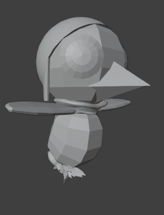
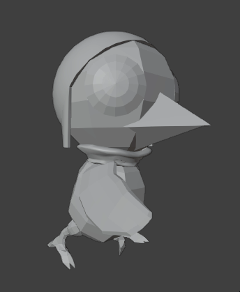
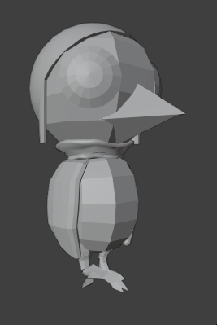
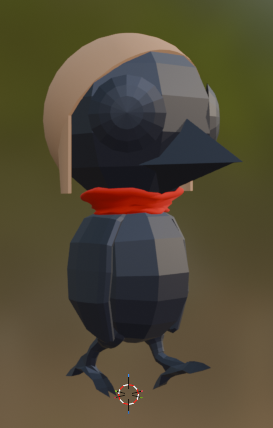

# Picture this:
You're working with Blender, an application for 3D modeling and animation. You have a super cool animation that you've been working on for the last two hours, or *multiple* animations over the course of the whole day. You think it looks great, so you press ctrl+S to *save* the project. Then, you go take a break because you just spent the last five hours staring at your computer screen. You breathe a sigh of relief as you glance over to the kitchen. A PB&J is calling your name. Five minutes later, PB&J in hand, you return to the computer and re-open the Blender project. You look around in the project for the animations you've just made.

They're gone.

A sinking in your stomach, a sweat on your brow. But you remember that Blender has a backup feature, you can open the last session that you quit. With as much dexterity as your clammy hands can muster, you navigate your mouse. File -> Recover -> Last Session. The familiar scene appears, but it doesn't have your work either. Panic starts to set in. Blender has autosaves, right? Right?? You go look at the set of autosaves available for you to recover. The last one was 7 hours ago. You didn't configure the autosave feature to autosave, you know, **automatically**.

Now imagine that, but repeat about four times. I did not figure out why my animations weren't being saved until after animating the same walk cycle four times... admittedly this was partially my fault, but the fact that blender has a system like this that does not warn you about its unusual and esoteric mechanism for saving animations is pretty damning for the application. I did gain some experience from it, so it wasn't all for naught.

# Animations and accessories
I hated the last walk and run animations, so I made new ones. I made two variations of the run animation and a walk cycle, and I'm pretty happy with the results, finally! I didn't hook up an IK rig to the leg because I couldn't figure it out. It was slowing me down. Besides, keying the feet to stick to the ground didn't take that long anyways.

{:refdef: style="text-align: center;"}

{: refdef}

Oh, and I also gave Mavi a couple of accessories. It felt better to have a scarf and aviator cap. Here's a view with some basic colors slapped on the mesh.

{:refdef: style="text-align: center;"}

{: refdef}

Unfortunately I didn't get as much done this week because of the issues I talked about before, and I also got caught up in some real-life stuff. Expect more next week, assuming blender doesn't delete more of my hard work without warning. I want to integrate these animations into the game using Godot's AnimationPlayer node and probably some kind of state machine.