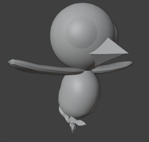
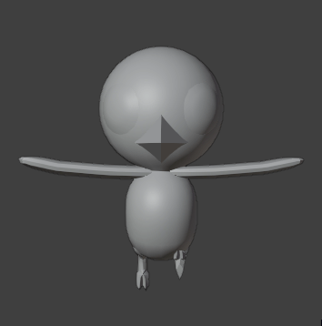
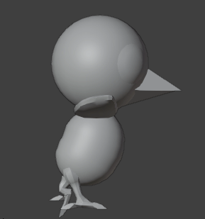
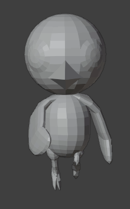
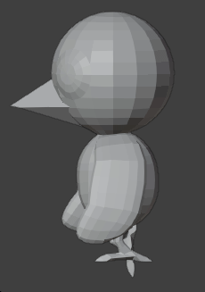
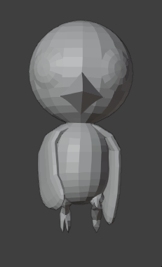
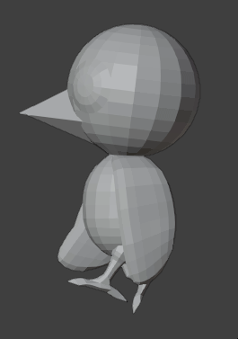
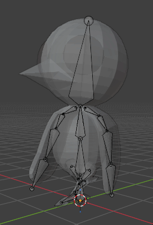
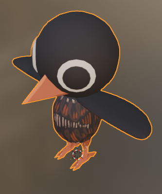
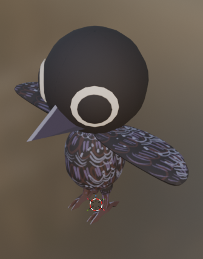

## A New Face
This week I spent my time modeling, unwrapping, and animating the protagonist of this little game, whose name I've decided will be Mavi. Full credit to my girlfriend for coming up with that one. It fits the bird and air navigation theme pretty nicely.

This week has been encouraging for me. When I started this project I wasn't sure if I could model and animate a character with results I feel is passable, let alone enjoy the task. Also, I hadn't animated in over four years. Thankfully the first iteration of Mavi turned out pretty good, in my opinion. I've included gifs of the best running animation I was able to produce, as well as ones that... aren't as good. I think you can guess which ones I wasn't very proud of.

I feel like this one turned out pretty good.
{:refdef: style="text-align: center;"}

{: refdef}

This was pretty awful. This does not feel like how a bird would run, so I scrapped it. It honestly feels like one of those canned animations that you get off of a website. Does not fit the character at all. The legs aren't even bending the right way!
{:refdef: style="text-align: center;"}

{: refdef}

This was my first attempt at a walk, and the first animation I tried to make. I was obviously rusty. You can see where the animation cycle loops, with an awkward pause between steps. I also included an xray view, so you can see how I rigged the model.
{:refdef: style="text-align: center;"}

{: refdef}

Also, my girlfriend drew some initial skins for Mavi. I think they turned out pretty well! I liked the colors, though be both agreed that the orange one looks a little too much like a penguin. She plans on doing more passes on Mavi's colors.
{:refdef: style="text-align: center;"}

{: refdef}

I plan on making/redoing some more animations. When I get them into the game and start doing animation state trees and blending, I think it will come together pretty nicely. I'm going to give myself another week to work on this, maximum.

## Still Missing Something

Even though I'm somewhat satisfied with the base model, I still think it's missing something. The character is too bland and not terribly recognizable. I think I need a couple of accessories to make the character more unique. So I figured I could add some things:
- Aviator cap
- Scarf
- Bag/Satchel

I'm a big fan of the aviator cap and the scarf, so I think I'll start with that. If I feel like Mavi needs a little bit more, I'll add a bag. I think that'll be good enough.

## Goals For Next Week

Next week I'm gonna have at least the accessories and all animations fully mapped out, and at least have some progress on incorporating the animations into the game. Stretch goal is to finish incorporating the animations into the game and the player controller, and also to start on environment design.