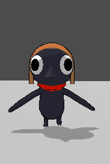
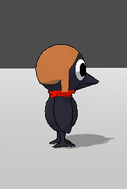
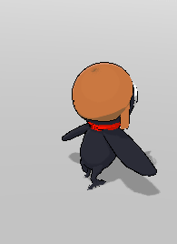
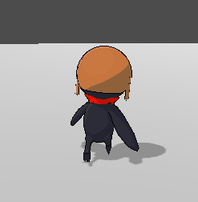
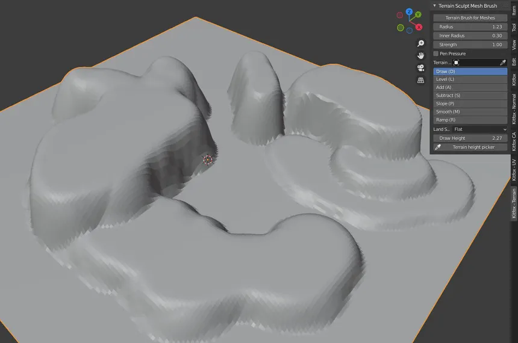
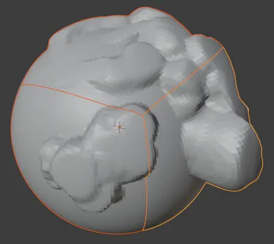
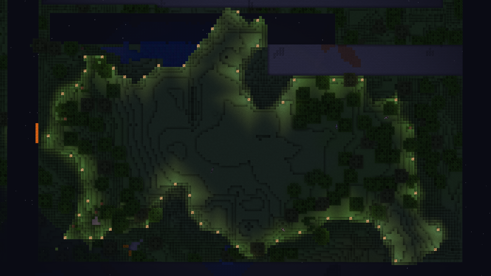
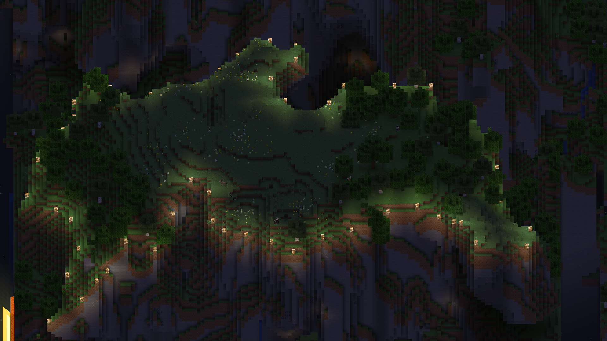
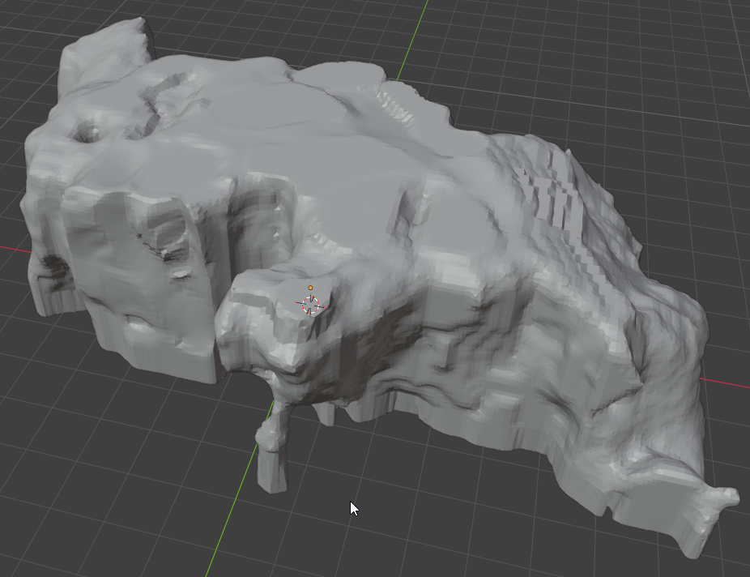
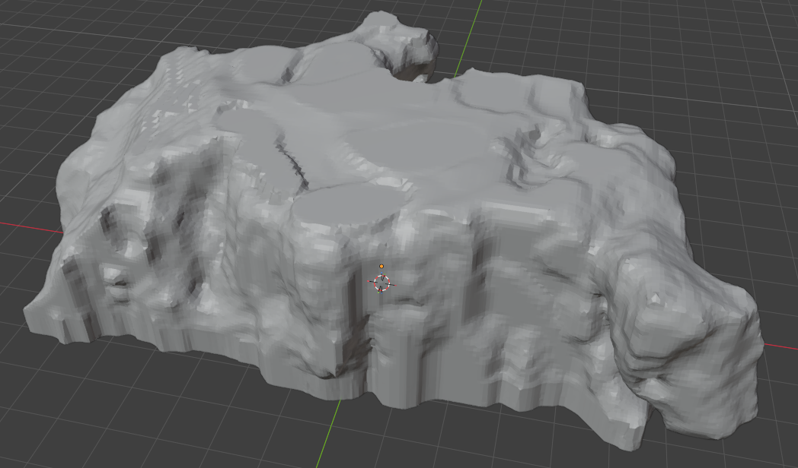

# Since last week
I spent my time integrating the animations into the game. It felt pretty good to see Mavi moving around like a real living thing. Even though this project is still very much in its infancy, simple visual flourishes really make it feel like it's coming together. This one has some cool in-game animations, as well as some of my early forays into environment design and terrain creation.

## Quick appreciation for cel/toon shading
I just want to say how AMAZING cel shading is. Who knew adding a little border around edges and flattening shading would become every indie dev's darling? It makes my crappy modeling and animations look so much better.

# Animations in game
Here Mavi is running and jumping. When the player is falling and holding the jump button, Mavi will flap their wings to try to stay in the air longer. I thought it'd be a cute little touch. Birds can't fly in this world, but they still try. Unfortunately, Mavi's fat little body is too heavy :(
There's a nice little transition between the rising and falling animation. For this an all animations I incorporated, I have custom transition conditions and calculations for each of them. I'll talk more about that later.

{:refdef: style="text-align: center;"}


{: refdef}

Mavi also has two running animations: one with Mavi running with arms down and swinging, and one with arms straight out like Mavi's pretending to be an airplane. I wasn't satisfied with just selecting one at random by some intangible heuristic, so I made it react to the player's behavior. If Mavi has been running in a straight line for a while, the airplane animation is used. Alternatively, if Mavi changes directions frequently, the swinging arms animation is used instead.

{:refdef: style="text-align: center;"}

{: refdef}

I still felt something was missing though so I looked to some other games for advice. In Super Mario Odyssey, Mario tends to lean pretty heavily in the direction that he's travelling. Looking at some other games reveals that this is *super common* and it feels great. A Hat in Time and Super Mario 64 also have some pretty heaving leaning in their games. I tried making Mavi lean a little, and realized unfortunately that I'd have to rework how Mavi is currently rigged *and* redo most of the animations to make Mavi lean as much as I'd like. So I settled for a slight lean for now.

I still think it turned out pretty good.

{:refdef: style="text-align: center;"}

{: refdef}

The transitions between animations still aren't perfect. There's some awkward snapping in weird places, so I'll need to revisit this at some point. For now, I'm satisfied.

## Technical explanation
I'm going to separate my more technical discussions about the features, because a lot of my friends and family that read these devlogs aren't technically minded. Feel free to skip these sections if you are one of those people.

The animation blending was done using Godot's animation blending tools, but the way the interpolation between the animations works is where the magic happens. Most of the animation blending is one-dimensional or additive. One-dimensional blending is when you have Animation `A` and Animation `B`. The blended animation takes the two and linearly interpolates between their states. Let's call the output animation `A->B(t)` where `t` is a real number `[0, 1]`. The closer `t` is to zero, the more weight `A` has on the output animation. Similarly, the closer `t` is to 1, the more weight `B` has.

Additive animation blending simply adds the two animations together to produce a result.

Most of the animation blending seen on Mavi is just simply modifying `t` in interesting ways to get the desired result. For example, the way the game decides which running animation to use (arms to side vs airplane) is by increasing `t` if the dot product of Mavi's velocity with Mavi's desired move direction is above a certain threshold. If it's below the threshold, `t` is reduced. Here's the code for those interested:

```
# Blend between the two running animations. As the player moves in a straight direction for longer, the second animation is favored.
var vel2 := Vector2(movement.relative_velocity.x, movement.relative_velocity.z).normalized()
var look2 := Vector2(appear_look_dir.x, appear_look_dir.z)
var dot_look := vel2.dot(look2)

var blend_run = AnimationController.get("parameters/grounded/blend_run/blend_amount")
if dot_look > 0.95:
    AnimationController.set("parameters/grounded/blend_run/blend_amount", lerpf(blend_run, 0, 0.01))
else:
    AnimationController.set("parameters/grounded/blend_run/blend_amount", lerpf(blend_run, 1, 0.05))
```

# Terrain
After I had the animations squared away last week, I still had a couple of days left. I decided my time would best be spent trying to find a solution for the terrain in the game.

I want the terrain to be fully 3D. I want to have overhangs, cool holes in the rocks, and formations to fly through. This means that most terrain editors available on the Godot asset store are not good for my use case. Most of them use what are called height maps to make their terrain, however those are strictly two-dimensional and do not allow for terrain with overhangs, caves, etc. I looked into voxel tools, but I wasn't satisfied with their terrain editing capabilities. So, I had to come up with another solution.

A deep, dark part of my mind craves to make my own voxel terrain plugin for Godot and use it to create the terrain, but I tried hard to fight it back. I reminded myself that I would like to finish this game within the decade. It's not a viable option. So, instead I just decided to use Blender to create the terrain 3D models using their sculpting tools. While not intended for and not particularly suited for terrain, the tools are robust and I know that I can do what is needed. I'll bet that there are even some tools out there specifically tailored for terrain editing and generation, which I may end up exploring in the future.

Here's a couple examples of sculpting terrain in Blender (grabbed off of a simple web search).

{:refdef: style="text-align: center;"}


{: refdef}

But there's a new problem that I don't have an easy solution to. I have **never** done any kind of environment design, and I simply had no idea where to begin. I started several times, but nothing felt right and I scrapped it all. So what I ended up doing was booting up Minecraft, creating a world with AMPLIFIED terrain, and search around for a cool land mass. I ended up finding one that I thought was pretty cool. So I installed software that allows me to pick a region in a Minecraft world and export it as a 3D object. Here's what the land mass looks like in game (I cut out sections of land around it):

{:refdef: style="text-align: center;"}


{: refdef}

I imported the object in Blender, remeshed it and cleaned it up, and here's the result:

{:refdef: style="text-align: center;"}


{: refdef}

So I guess that means I should probably attribute Minecraft in the credits, right?

I think the result ended up alright. Since these are sea stacks, I'll want the walls to be a dark rocky texture. I think for the starting area, I want it to be a farming village. Simple origins for our main character. It'll make the sights in other areas in the game much more impactful in comparison.

The top of the sea stack is going to be grassy and covered in wheat, and I imagine the main export from this village will be wheat/agriculture. It doesn't make a whole lot of physical sense, as I'm not sure where the water would come from and a sea stack isn't well known for its fertile soil. My response is: who cares, it's a video game! It doesn't have to make sense all of the time, but it helps if it makes sense *most* of the time. I think I can overlook this.

# Next week
Next week I want to spend more time making the terrain I have look nice. Make some shaders for it, give it some rocky edges and cool foliage.

# AI disclosure
I'm going to start including this disclosure in all of my devlogs as a reminder to those reading, and myself, that no AI was used in any way in the development of this game, or in the writing of any of my devlogs. I personally find AI to be corrosive to my enjoyment of the development process. It's more important to me that I create something I enjoy.
